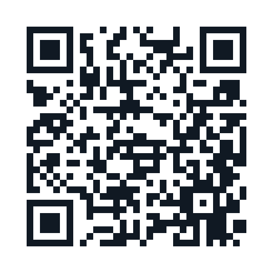
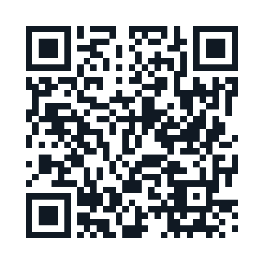
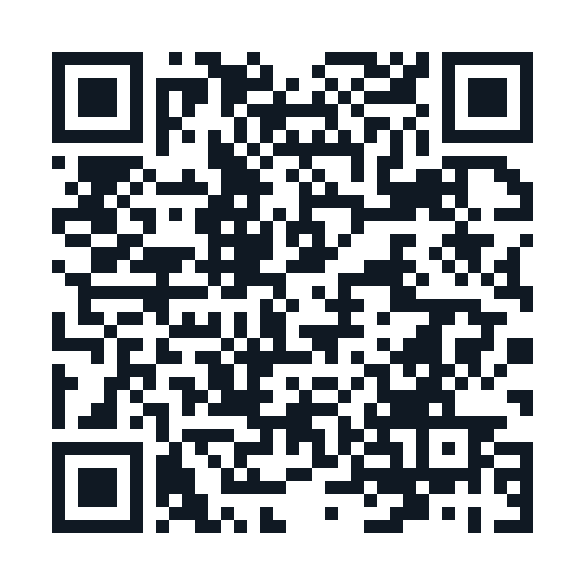

# VR 가상현실 콘텐츠 제작 실습 자료

김인권 지음 · 아이스큐브랩

문과 차단기를 확인하는 언리얼 점검실, 전시를 편집하는 달의 기록관, 관측기를 조립하는 궤도 정비소, 12초 공연을 만드는 소리극장, 물때를 읽고 배를 보내는 해협 우편선을 수록했습니다.

[브라우저 작품실 열기](https://ingunbi.github.io/vr-content-studio-samples/) · [Windows 실습 자료와 언리얼 원본 받기](https://github.com/ingunbi/vr-content-studio-samples/releases/tag/v1.0.0)

| 작품 | 첫 실습 | 자료 |
|---|---|---|
| VR 안전 점검실 | `1`, Enter, `2`, Enter로 두 대상을 확인하고 `3`, Enter로 초기화합니다. | [Windows 실행 파일과 UE 5.8.4 프로젝트](https://github.com/ingunbi/vr-content-studio-samples/releases/tag/v1.0.0) |
| 달의 기록관 | 작품의 면을 조사해 단서를 채록하고 전시 순서와 해설을 정합니다. | [전시장 입장](https://ingunbi.github.io/vr-content-studio-samples/?project=gallery) · [소스](docs/projects/gallery) |
| 궤도 정비소 | 반사경·필터·센서를 조립하고 암전 보정 뒤 스펙트럼을 읽습니다. | [정비소 열기](https://ingunbi.github.io/vr-content-studio-samples/?project=repair) · [소스](docs/projects/repair) |
| 비 오는 밤의 소리극장 | 비·종·막차의 세기와 위치를 바꾸고 3막 공연을 재생합니다. | [무대 열기](https://ingunbi.github.io/vr-content-studio-samples/?project=sound) · [기본 악보 WAV](https://ingunbi.github.io/vr-content-studio-samples/projects/sound/opening-score.wav) · [빗소리판 WAV](https://ingunbi.github.io/vr-content-studio-samples/projects/sound/curtain-of-rain.wav) · [소스](docs/projects/sound) |
| 해협 우편선 | 예정표를 작성한 뒤 출항합니다. 실제로 도착한 기록은 ‘일지 저장’에서 받습니다. | [항구 열기](https://ingunbi.github.io/vr-content-studio-samples/?project=post) · [항해 작업지](https://ingunbi.github.io/vr-content-studio-samples/projects/post/chart.html) · [소스](docs/projects/post) |

처음부터 카메라와 광선을 만들어 보려면 [시선 측정실 4단계](https://ingunbi.github.io/vr-content-studio-samples/starter/index.html)를 엽니다. 데스크톱에서는 마우스 클릭, 오른쪽 버튼 드래그, 방향키와 Enter로 조작합니다. 실제 헤드셋에서는 브라우저가 HTTPS와 몰입형 WebXR 세션을 지원해야 합니다. 실기 착용, 추적 회복, 양안 가독성은 장비에서 별도로 확인하세요.

## 내 컴퓨터에서 수정하기

Windows에서 실행만 할 때는 릴리스의 `VR-Studio-Windows-x64.zip`을 통째로 풀고 `VR작품실.exe`를 엽니다. 실행기를 열어 둔 동안 로컬 웹 서버가 동작합니다. 이 폴더의 `web`이 저장소의 `docs`와 같은 역할을 합니다.

브라우저 소스를 수정하려면 이 저장소를 내려받고 `docs` 폴더에서 아래 명령을 실행합니다. Python 3가 필요합니다. 브라우저에서 [로컬 작품실](http://127.0.0.1:8000/)을 열고, 소스를 바꾼 후 새로 고칩니다.

```sh
python -m http.server 8000 --bind 127.0.0.1
```

Node.js로 확인하는 수업 예제도 있습니다. 아래 명령은 `docs` 폴더에서 실행합니다.

```sh
node --test projects/gallery/tests/archive.test.mjs projects/gallery/tests/editions.test.mjs
node projects/repair/qa/boundary.mjs
node projects/post/qa/check.mjs
node projects/post/qa/read-journal.mjs "projects/post/qa/항해일지_14분.json"
```

점검실의 2/2와 공조 표시등을 더한 3/3 편집 프로젝트는 릴리스에서 각각 받을 수 있습니다. 압축을 서로 다른 폴더에 풀고 Unreal Engine 5.8.4에서 `Inspection/Inspection.uproject`를 엽니다. 통합 Windows ZIP에는 두 소스 ZIP이 `source`에 들어 있습니다. 기본 실행기는 2/2 버전을 엽니다. 3/3 확장판은 에디터에서 열거나 별도로 Windows 패키징합니다.

## 예제에 딸린 기록

[점검실 결과](evidence/inspection)와 [표시등 확장 결과](evidence/airlamp)에서 확인 상태, 레벨 구성과 실행 화면을 읽을 수 있습니다. 웹 작품의 `tests`·`qa` 폴더에는 원고의 연습에 쓰는 코드·예시 값이 있습니다. 공개 자료에는 제작 PC가 남긴 원시 엔진 로그, 명령줄과 기기 식별 내역이 빠져 있습니다. 로컬에서 재현할 때 새 로그는 직접 구동한 언리얼 프로젝트의 `Saved/Logs`나 브라우저의 개발자 도구에서 확인합니다.

## QR 이미지

스캔하면 각각 이 저장소, 온라인 작품실, 책과 짝이 맞는 v1.0.0 다운로드가 열립니다.

| 실습 소스 | 온라인 작품실 | Windows 다운로드 |
|---|---|---|
| [](https://github.com/ingunbi/vr-content-studio-samples) | [](https://ingunbi.github.io/vr-content-studio-samples/) | [](https://github.com/ingunbi/vr-content-studio-samples/releases/tag/v1.0.0) |

동봉한 Three.js 0.160.1의 배포 조건은 [MIT 라이선스 전문](docs/vendor/THREE-LICENSE.txt)에서 확인할 수 있습니다. Unreal Engine 및 Epic Games의 VR 템플릿에는 [Unreal Engine 라이선스](https://www.unrealengine.com/eula/unreal)가 적용됩니다.
